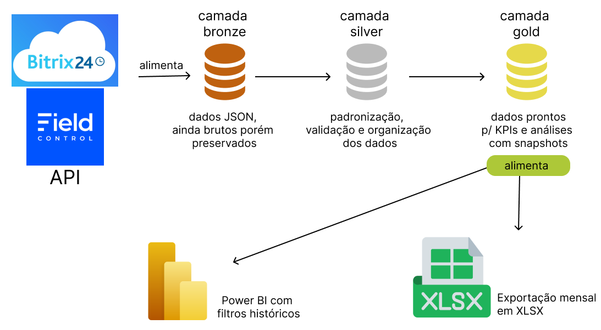

# Extrator de Relatórios Bitrix24 & Field Control

Projeto de dados que extrai informações de CRM do **Bitrix24**(de forma incremental) e ordens de serviço do **Field Control** (por janelas de meses), as organiza em arquitetura medallion em um banco **PostgreSQL** e alimenta o Power BI e relatórios XLSX. 

**Status**: trabalho em progresso. Este documento descreve a arquitetura-alvo, quais foram as decisões tomadas e a responsabilidade de cada camada. Este README.md será atualizado e encurtado ao longo do projeto, quando os arquivos .md das demais pastas forem apropriamente atualizadas.


## Sumário 

1. **Objetivo**
2. **Visão Geral**
3. **Stacks e configuração**
4. **Decisões de arquitetura**
5. **Resumo das camadas**
6. **Estrutura do Projeto**


## Objetivo

- Guardar o histórico dos resultados da empresa. O B24 mantém somente o estado atual de cada card. 
- Dados de manutenções preventivas realizadas por mês serão extraídas a partir do Field Control. 
- Permitir filtros **mensais e anuais** sem depender diretamente da API. 
- Gerar arquivos em .xlsx de resumo claros para envio à gestão. 
- Garantir que Power BI e relatórios leiam da **mesma fonte**.
- Escalar com o cresimento do número de cards sem reler a base inteira a cada execução. 


## Visão geral



| Schema | Conteúdo | Quem escreve | Quem lê |
|---|---|---|---|
| `bronze` | Dados brutos devolvidos pela API | Python (extract) | Python (silver) |
| `silver` | Estado atual de cards e OS, limpos e validados | Python/pandas | Python, SQL(gold) |
| `gold` | Visões de negócio prontas para consumo | SQL(views) | Power BI e Excel |
| `ctrl` | Controle de execução e qualidade | Python | Python |

Possuímos um único banco e vários schemas. A gold é construída por SQL direto sobre a silver, e as permissões são separadas por schema. 


## Stacks e configuração

| Ferramenta | Propósito |
|---|---|
| Python 3.10+ | Orquestração do ETL |
| pandas | Limpeza e padronização (camadas bronze e silver) |
| SQLAlchemy + psycopg | Conexão com PostgreSQL |
| PostgreSQL | Armazenamento das camadas |
| Power BI | Dashboards, via conector PostgreSQL |

```
git clone <url-do-repositorio>
cd projeto-bi-bitrix

python -m venv .venv
source .venv/bin/activate        # Windows: .venv\Scripts\activate
pip install -r requirements.txt

cp .env.example .env             # preencha os valores reais
```

| Variável | Descrição |
|---|---| 
| `BITRIX_WEBHOOK_URL` | URL do webhook do Bitrix24 |
| `DB_HOST`, `DB_PORT`, `DB_NAME` | Conexão com o PostgreSQL |
| `DB_SSLMODE` | Ex.: `require` |
| `DB_ETL_USER`, `DB_ETL_PASSWORD` | Role do ETL |
| `DB_BI_USER`, `DB_BI_PASSWORD` | Role somente da leitura da gold |
| `INCREMENTAL_OVERLAP_MINUTES` | Margem de sobreposição da carga incremental |
| `FATURAMENTO_JANELA_MESES` | Quantos meses recentes a gold deve recalcular a cada execução |

Agendamento (cron), logs e restauração: `docs/OPERACAO.md`.


## Decisões de arquitetura

| Decisão | Motivo | Rever caso: |
|---|---|---|
| **Arquitetura medallion** | Separa o que veio da API (bronze), o que foi tratado (silver) e o que a gestão deve consumir (gold) | Se a manutenção das camadas ficar mais trabalhosa que o benefício |
| **Bitrix24 em carga incremental** | O volume de cards tende a crescer, e reler todo dia todo o conteúdo extraído aumenta o tempo e consumo da API sem necessidade | Se o incremental ficar instável, uma carga completa diária é válida enquanto o volume for baixo |
| **Field Control por janela de meses, sem marca** | O volume de OS com a tag é menor. Refazer a janela inteira a cada execução captura mudanças de status, tags removidas e OS canceladas, dispendando a reconciliação de exclusões para essa fonte | Se o volume de OS crescer muito |
| **Bronze genérica (`raw_items`) em uma única tabela com JSONB** | Uma única rotina de carga serve para todas as fontes, e campos novos do Bitrix não quebram a carga. A tabela cresce somente com número de itens, não com as alterações | Se for necesspario auditar versões antigas, passar a gravar cada versão como uma nova linha |
| **Carga de reconciliação semanal só de ids(Bitrix)** | A carga incremental não mostra itens excluídos no Bitrix. Comparar ids existentes com silver detecta exclusões sem baixar tudo | Se o Bitrix passa a oferecer uma lista de exclusões confiável |
| **Silver com pandas, gold com SQL** | Limpeza de JSON e de campos personalizados é mais simples em python, enquanto agregações por mês e ano são mais rápidas e claras no banco | Se a limpeza ficar toda no SQL, simplificar |
| **Gold como views comuns, sem materialização** | Com o volume atual, views respondem rápido e nunca ficam desatualizadas. Materializa-se depois, se necessário | Caso uma consulta ao Power BI fique lenta |
| **Estados por camada em `ctrl`** | Cada lote tem status separado por camada. Caso a silver falhe, pode reprocessar a partir da camada bronze sem chamar a API | - |
| **Sem orquestrador(Airflow, etc)** | Usaremos o cron que já resolve o agendamento. Menos peças para manter | Se surgirem dependências entre muitos jobs |
| **Menor privilégio por role** | O Power BI e Xlsx. lêem somente a gold. Quem escreve é a role do ETL | - |


## Resumo das camadas

### bronze

Armazena os dados brutos retornados pelas APIs do Bitrix24 e do Field em formato JSONB.

- Preserva os campos retornados pelas fontes sem exigir um mapeamento prévio de todos eles.
- Permite reconstruir a camada Silver sem consultar novamente a API, utilizando o conteúdo bruto mais recente armazenado.
- Utiliza operações de upsert para atualizar os registros existentes.
- Não utiliza chaves estrangeiras para não criar dependências desnecessárias durante a ingestão.

### silver

Armazena os dados padronizados e tratados, representando o estado atual dos registros.

- Converte os dados brutos para tipos adequados ao PostgreSQL.
- Padroniza nomes de campos e trata campos personalizados.
- Mantém relacionamentos entre entidades por meio de chaves primárias e estrangeiras, quando aplicável. 
- Utiliza upsert para permitir o reprocessamento idempotente dos dados.
- Mantém registros que deixaram de existir na origem marcados como excluídos logicamente, quando aplicável. 

### gold

Disponibiliza os dados preparados para consumo pelo Power BI e pelos relatórios Excel.

- Contém views SQL com indicadores e informações consolidadas para a gestão. 
- Consulta os dados tratados da Silver.
- É a única camada de dados acessada pelas ferramentas de consumo. 
- Utiliza views comuns inicialmente, sem materialização. 

### ctrl 

Armazena informações de controle da execução do ETL.

- Registra os lotes processados e o status de cada camada.
- Mantém as marcas utilizadas para controlar a extração incremental.
- Permite identificar falhas e reprocessar dados a partir da Bronze, quando possível. 
- Armazena informações necessárias ao monitoramento da execução.


## Estrutura do projeto

```
projeto-bi/
│
├── README.md
├── .env.example
├── .gitignore
├── requirements.txt
│
├── config/
│   ├── sources.yml --define quais fontes consultar, quais métodos de API utilizar e quais campos de data ou filtros considerar
│   └── field_mapping.yml --define como renomear, interpretar e converter os campos recebidos para o formato da Silver
│
├── etl/
│   ├── extract/    --consulta as APIs
│   │   ├── bitrix/
│   │   │   ├── __init__.py
│   │   │   ├── users.py
│   │   │   └── crm.py
│   │   └── field_control/
│   │       ├── __init__.py
│   │       └── work_orders.py
│   │
│   ├── bronze_to_silver/   --limpa e padroniza os dados com pandas
│   │   ├── __init__.py
│   │   ├── users.py
│   │   └── comercial_cards.py
│   │
│   ├── reconcile/      --identifica registros que deixaram de existir no Bitrix
│   │   ├── __init__.py
│   │   └── bitrix.py
│   │
│   ├── gold/       --executa o processamento necessário para disponibilizar indicadores
│   │   ├── __init__.py
│   │   └── monthly_metrics.py
│   │
│   ├── common/     --concentra funções compartilhadas
│   │   ├── __init__.py
│   │   ├── database.py
│   │   ├── logging_config.py
│   │   └── batch_control.py
│   │
│   └── main.py     --coordena a execução das etapas
│
├── db/
│   ├── bronze/     --tabelas para os dados brutos  
│   │   └── 01_create_bitrix_raw.sql
│   ├── silver/     --tabelas tratadas e relacionamentos
│   │   ├── 01_create_dimensions.sql
│   │   └── 02_create_cards.sql
│   ├── gold/       --views para Power BI e relatórios
│   │   └── 01_create_views.sql
│   ├── ctrl/       --tabelas de controle de execução e lotes
│   │   └── 01_create_control_tables.sql
│   ├── roles/      --permissões dos usuários do banco
│   │   └── 01_create_permissions.sql
│   └── README.md
│
├── reports/
│   ├── README.md       --documenta os relatórios e indicadores
│   ├── generate_reports.py     --consulta os dados e gera os arquivos .xlsx.
│   └── output/     --recebe os arquivos gerados
│       └── .gitkeep
│
├── powerbi/
│   └── README.md       --explica a conexão com PostgreSQL, medidas DAX, calendário e atualização dos dados
│
├── docs/
│   ├── ARQUITETURA.md      --explica as camadas, o fluxo e decisões da arquitetura
│   └── OPERACAO.md     --explica como executar, agendar, diagnosticar falhas e recuperar o processamento
│
└── tests/      --verificam se a extração, as transformações e reconciliação funcionam conforme esperado, sem precisar executar todo o ETL a cada teste
    ├── test_extraction.py
    ├── test_transformation.py
    └── test_reconciliation.py
```

---

💻 Desenvolvido por [Jéssica Duarte](https://github.com/jessica-mduarte) 
